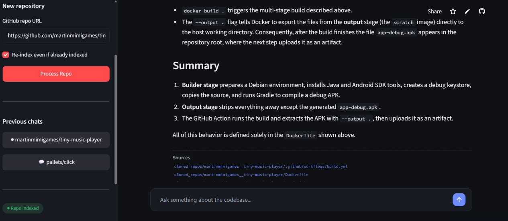
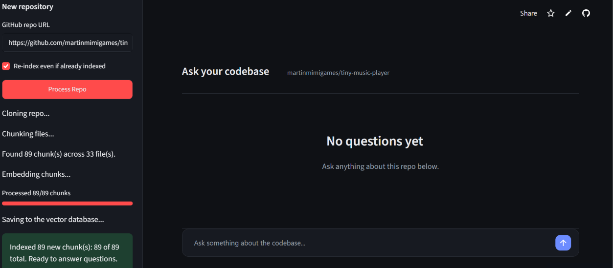

# AskMyRepo

Ask questions about any public GitHub repository in plain English and get answers that cite the source files they came from.

**Live demo:** https://askmyrepo.streamlit.app

## What it does

Paste a GitHub repo URL, let the app index it, then ask things like *"How does this app connect to a database?"* or *"Where is authentication handled?"*. Each answer is generated from the code and docs that were actually retrieved, and the files used are listed under the answer. If the retrieved code doesn't contain the answer, the assistant says so instead of guessing.

**Features**
- Chat interface in a dark theme, with one conversation per repo and a **Previous chats** list in the sidebar (like ChatGPT).
- Syntax-aware code chunking with tree-sitter for Python, JavaScript, TypeScript, Java, C, C++ and Go, with a fallback splitter for other text files. Binary files are skipped.
- Source-first indexing: main source files are embedded before tests, examples and docs, so big repos give useful answers early.
- Batch indexing for large repos, with an **Index next 250 chunks** button and a coverage display ("Indexed 250 of 1,635 chunks").
- Re-opening a repo that is already indexed is instant and uses no embedding quota.
- Several repos can be indexed side by side. Each chat only searches its own repo.

## Screenshots

**A cited answer.** The assistant explains how a repo's Docker build and GitHub Action work, and lists the files it used under the answer. The sidebar keeps one chat per repo under Previous chats.



**Indexing a repo.** Paste a GitHub URL and the app clones it, chunks the files, embeds the chunks and saves them to the vector database, then opens an empty chat for that repo.



## How it works

```
GitHub repo URL
      |
      v
 Clone  ->  Chunk (tree-sitter)  ->  Embed (Gemini)  ->  Store (Zilliz Cloud)
                                                              |
Question -> Embed (Gemini) -> Vector search (filtered to the repo) -> Top matches
                                                              |
                                  Prompt with retrieved code -> Groq LLM -> Cited answer
```

| Step | Tool |
|---|---|
| UI | Streamlit |
| Cloning | GitPython |
| Chunking | tree-sitter (language grammars) with a fallback splitter |
| Embeddings | Google Gemini `gemini-embedding-001`, 768 dimensions |
| Vector database | Zilliz Cloud (managed Milvus), cosine similarity |
| Answer generation | Groq, `openai/gpt-oss-120b` |

## Design decisions

- **One shared collection, filtered by repo.** Every chunk is tagged with its repo, and searches filter on that tag. Different repos and different visitors don't overwrite each other, and nothing has to be dropped and recreated.
- **Throttled, retrying embedding calls.** The Gemini free tier has per-minute and per-day request limits. Requests are paced across threads, and rate-limit (429) responses are retried with backoff.
- **Indexing order.** Chunks are sorted source code first, tests and examples next, docs and config last. Combined with batch indexing, a partial index still covers the code people ask about.
- **Honest answers.** The prompt tells the model to use only the retrieved context and to say when it isn't enough. The UI also shows how much of a repo is indexed, so a "not covered" answer isn't mistaken for a bug.
- **Hosted services over self-hosting.** Zilliz, Gemini and Groq replaced a local Docker + Ollama setup so the app can run on Streamlit Community Cloud with no infrastructure to manage.

## Run it locally

You need Python (built and tested on 3.14) and free accounts for [Zilliz Cloud](https://zilliz.com/cloud), [Google AI Studio](https://aistudio.google.com/app/apikey) and [Groq](https://console.groq.com).

```bash
git clone https://github.com/rizwanuljannah/askmyrepo.git
cd askmyrepo
python -m venv venv
venv\Scripts\activate          # Windows; on macOS/Linux: source venv/bin/activate
pip install -r requirements.txt
```

Create a `.env` file in the project root:

```
MILVUS_URI=your-zilliz-cluster-endpoint
MILVUS_TOKEN=your-zilliz-api-key
GEMINI_API_KEY=your-gemini-api-key
GROQ_API_KEY=your-groq-api-key
```

Then start the app:

```bash
streamlit run app.py
```

The app creates its vector collection automatically the first time you process a repo. Your `.env` file is listed in `.gitignore`, so keys are never committed.

## Deploying

The live demo runs on Streamlit Community Cloud. To deploy your own copy, connect the repo, set `app.py` as the entry point, and add the same four values (`MILVUS_URI`, `MILVUS_TOKEN`, `GEMINI_API_KEY`, `GROQ_API_KEY`) in the app's **Secrets** settings.

## Project structure

```
app.py                 Streamlit UI, chat history, indexing flow
chunk_repo.py          Clones the repo and walks its files
chunk_code.py          tree-sitter based chunking and language map
embed_repo.py          Gemini embeddings (throttled, with retries)
search_chunks.py       Vector search against Zilliz, optionally filtered by repo
query_assistant.py     Builds the prompt and calls Groq for the cited answer
insert_into_milvus.py  Command-line helper for indexing a repo
requirements.txt       Python dependencies
.streamlit/config.toml Dark theme
```

## Known limitations

- **Free-tier API limits.** Gemini's free embedding quota is limited per minute and per day, so large repos are indexed in batches of 250 chunks. Indexing about 250 chunks takes a few minutes.
- **Chat history lives in the browser session.** Refreshing the page clears the Previous chats list. The indexed repos stay in the database, so pasting the same URL reopens one instantly, but earlier messages aren't saved.
- **Public GitHub repos only.**
- **Answers are limited to what was indexed.** For partially indexed repos the app shows the coverage so you know what the assistant can see.

## Also built: self-hosted version

This project started as a fully local setup: Docker Compose running Milvus, with Ollama serving `nomic-embed-text` for embeddings and `llama3.2:3b` for answers, so it could work without internet after setup. The version in this repository is the cloud-hosted adaptation of it. <!-- Add the link to the self-hosted repo here once it is published. -->